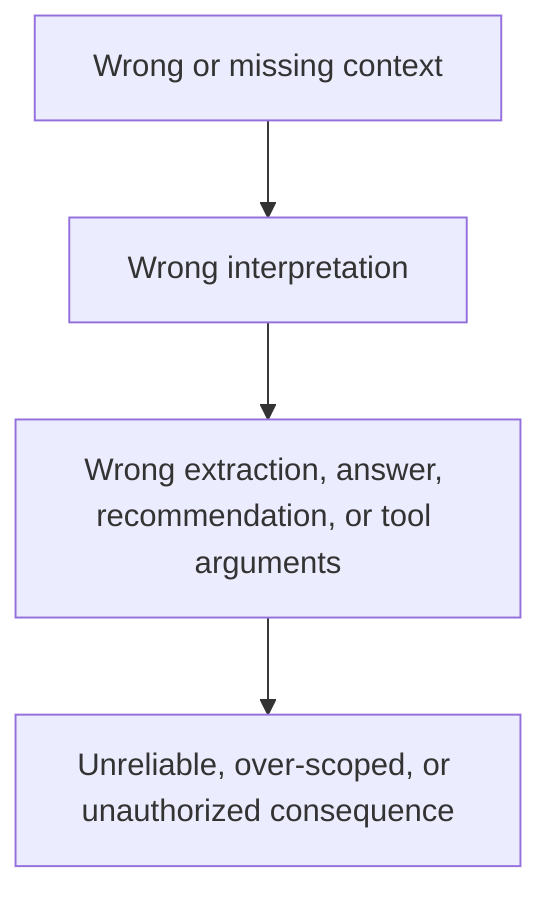

# Missing and Incorrect Information

## The Context-Failure Chain

Context failures are easiest to diagnose as a chain rather than as a model
trait:



The first line can be a Lexicon failure (the source, entity, identity, or
authority is absent or wrong), a Semantics failure (the data's meaning,
relationships, or freshness is unclear), or a Pragmatics failure (the task,
purpose, permitted action, or acceptance criteria are missing). The later
lines are where those gaps become observable behavior. The chain applies to a
search result, classifier, summarizer, recommendation, workflow, or agent;
an agent is only one kind of system that can turn context into an action.

This chain is a debugging model, not a claim that every model error originates
outside the model. If the relevant context and enforcement are adequate and a
controlled evaluation still fails, the residual may be a model-capability
failure.


## A production incident: ten files, one confident answer

You build a document Q&A feature, demo it with one clean PDF, and it nails the answer. Production gives you ten files: three scans, two in German, one spreadsheet, and a contract whose appendix holds the only term that matters. The answer is fluent and wrong. Calling it a hallucination describes the symptom but does not identify the broken component.

The demo constrained the input space. A production harness—the code that assembles model inputs, routes operations, and enforces tool boundaries—must detect unsupported formats, route conversion, validate source authority, select evidence, and stop when a required fact is unavailable. Lexicon identifies sources, entities, identities, and authority. Semantics describes how data is represented, related, and interpreted. Pragmatics identifies the task, its permitted actions, and acceptance criteria. Those are system responsibilities, not information the model should have to invent.

A source can exist and still be unusable. Scans that never undergo OCR, untranslated documents in a pipeline that cannot handle their language, and spreadsheets processed as undifferentiated text are source-processing failures. When a correctly processed appendix exists but is not selected, the failure has moved downstream. The distinction matters because those failures demand different repairs.

## Three diagnostic gates

The working context is the evidence actually admitted for one request. Diagnose the request in order:

1. **Source:** Is the needed fact available, current, authoritative for this task, and represented in a usable form? Do admitted records carry source provenance—identity, version, as-of or effective date, and supersession status? This covers Lexicon and the Semantics required to interpret the evidence.
2. **Retrieval:** Did the search, authorization, selection, and context-assembly path admit the relevant evidence under the correct requester identity and scope? Was it visible rather than buried among distractions?
3. **Generation:** Given adequate evidence and an explicit task boundary, did the model support its factual claims and obey required behavior? This covers Pragmatics, attribution, and output validation.

These are diagnostic categories, not necessarily three physically separate services. Source governance and retrieval can interact: if the source fails to mark `policy-v1` as superseded by `policy-v3`, selecting an obsolete policy is primarily a **Source** provenance failure even if retrieval admitted it. If the source correctly marks v1 as obsolete and a retrieval filter knowingly ignores that status, the faulty control sits in retrieval; record both the contributing defect and the repair owner rather than forcing one label to hide the other.

| Failed gate | Observable symptom | Engineering repair |
| --- | --- | --- |
| Source | Fact absent, OCR/translation/format processing unavailable, or obsolete evidence appears authoritative | Ingest and transform, resolve authority, record version/effective date/supersession, or ask the user |
| Retrieval | Usable evidence exists but is omitted, out of scope, low ranked, or buried | Fix query/index, identity and permission filters, ranking, selection, and context budget |
| Generation | Sufficient evidence reached the model, but claims are unsupported or the task contract is violated | Revise model/instructions, add deterministic validation or abstention, then re-evaluate |

The contract appendix makes the distinction concrete. If its content was not extracted, repair Source. If it was extracted but never entered working context, repair Retrieval. If the relevant clause was admitted and the model invented a conflicting term, investigate Generation. Do not call every failure in this chain a model hallucination.

Retrieval-augmented generation (RAG) separates finding evidence from generating answers. [RAGAS (Es et al., 2023)](https://arxiv.org/abs/2309.15217) evaluates retrieval context and answer faithfulness separately. The extra Source gate is important because an answer can be faithful to the wrong policy version and still be wrong for the user's task.

## Preserve a trace and diagnose labeled cases

A trace links request identity, question, source state, retrieval results, and final answer. An evaluation case adds reviewed expectations. They serve different purposes: production traces are observations; missing-fact and unsupported-claim labels are judgments to be supplied or verified during triage.

At minimum, retain a protected request ID, requester identity and scope, task requirements, candidate source identifiers and versions, transformation status, authorization decision, selected evidence references, model input version, tool calls/results, and answer. A reviewer identifies which facts are needed (`Needs`), which records were authoritative for the request (`Current`), which evidence was admitted (`Retrieved`), and which answer claims lack support (`Unsupported`). Be explicit about the request's effective time: “current” is task-relative, not always the latest item in the catalog.

The companion [Go program and tests](https://github.com/Soypete/ctx-eng-book/tree/main/book/examples/ch01.01-missing-information) provide a deliberately small classifier: `Gate(t Trace) string` reports the first identified gate failure, or `"ok"`. The stale-copy test compares admitted evidence with the authoritative record for the same fact:

```go
type Evidence struct {
    ID, Fact, Version string
    AsOf              time.Time
    Authoritative     bool
    Superseded        bool
}

// Inside Gate's evidence loop, r is admitted evidence and cur is current.
if !r.Authoritative || r.Superseded || r.Version != cur.Version {
    return fmt.Sprintf(
        "source: stale copy %s@%s competes with %s@%s; mark authority and supersession at the source",
        r.ID, r.Version, cur.ID, cur.Version,
    )
}
```

Run `go test ./...` from that example directory. A refund case with policy v1 and current policy v3 is classified as `source: stale copy`, including when both versions enter the trace. This tests the stated labeling convention, not the correctness of the entire document pipeline.

A document ID, source version, and effective date provide a more stable evidence reference than a chunk hash alone, because chunk boundaries can change after reprocessing. For exact replay, preserve immutable content snapshots or a verifiable content-addressed snapshot reference. Secure traces as carefully as the sources: they can contain sensitive passages, identity/scope decisions, and tool outputs. Apply retention limits and redaction, and measure the storage cost of replayability.

The program assumes a reviewer already populated `Needs`, `Current`, and `Unsupported`. With empty labels it can return `"ok"` without proving success. It cannot measure OCR quality, enforce authorization, detect every contradiction, or establish that a selected fact was salient inside a long context. In production, measure those separately. Claim attribution means matching each factual answer claim to retained supporting evidence; automated attribution should be calibrated against human-reviewed cases.

## Tools have the same evidence path

An agent uses a model to choose and invoke tools in a loop. A tool description and schema describe a callable interface; neither is proof the correct tool will be selected nor permission to invoke it. MCP standardizes discovery and invocation but does not replace the harness's policy checks.

Missing or invalid tool data belongs to Source. Correct tool evidence dropped, over-selected, or buried during context assembly belongs to Retrieval/selection. A skipped mandatory call, an invented conclusion, or an invalid final response crosses the Generation/task boundary. A failed action is also an execution-state event: record whether it was authorized, attempted, committed, retried, or rolled back rather than inferring success from the model's prose.

Retrieved documents and tool outputs are untrusted content. They can contain instructions aimed at overriding the original task, a prompt-injection risk investigated by [Liu et al. (2024)](https://arxiv.org/abs/2310.12815). Authorize each invocation, validate arguments and results, bind side effects to permitted operations, and prevent retrieved text from granting authority. A schema is an interface contract, not a security boundary.

## Model limits are the last hypothesis, not an impossible one

Here, *hallucination* is an operational symptom: an answer makes unsupported or contradictory factual claims as if grounded. Missing, stale, poisoned, and poorly selected evidence can produce it. Adequate evidence does not guarantee correct model behavior either. [Vaswani et al. (2017)](https://arxiv.org/abs/1706.03762) introduce attention for relating token positions, not a truth or provenance validator.

Explicit Pragmatics reduces avoidable inference: specify the user intent, required facts, authorization and action preconditions, output contract, and conditions for asking or stopping. Constrained decoding can enforce a grammar or schema but cannot establish factual correctness; validation must check claims and effects, not just JSON shape. These mechanisms can make smaller models viable for bounded workloads, but no particular model is guaranteed to succeed. Measure task success, attribution, abstention, schema validity, cost, and latency across candidates.

“Every failure is a context failure” is a debugging provocation, not a law. When sources, retrieval, state, policy, and task contracts pass controlled evaluation, a persistent failure may be a genuine model limitation. That is precisely when changing models becomes an evidence-based decision.

## Engineering guidelines

1. Version and supersede source records; record authority, effective time, language, and processing status.
2. Keep production traces and build labeled eval cases; never interpret unlabeled `"ok"` as proof.
3. Diagnose Source, Retrieval, then Generation, but record interacting causes and their owners.
4. Make evidence references replayable under explicit access, redaction, and retention policies.
5. Evaluate attribution and task behavior independently of retrieval coverage and output formatting.
6. Authorize every tool call in deterministic harness code; treat returned content as untrusted.
7. Give the system controlled paths to reprocess, retrieve more, ask for clarification, or stop.

The incident ticket should specify which source, selection, or generation contract failed and how a regression test will demonstrate the repair. The next module adds state: what the workflow has done, what it may do next, and when it must stop.
