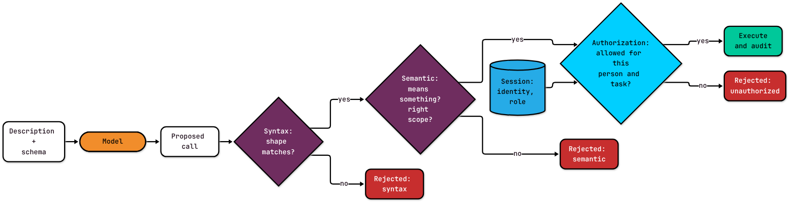

A support assistant has two tools: `create_customer` and `get_customer`. Someone types "Move ana@example.com to the pro plan." Ana is already a customer. There's no tool for changing plans.

The model proposes `create_customer` with Ana's email, her name, and `tier: "pro"`. Every field is present, every type is right, and `pro` is one of the allowed plan names. The call passes validation. Now there are two Anas.

That one is invented, but you've probably shipped its cousin. The schema did its job perfectly. Nobody asked it the right question.

This is part of my [context engineering series](https://substack.com/@soypetetech). Last time I argued that a model's request to use a tool is only a proposal, and your application code decides what runs. This post is about what that code needs to know to make the decision.

## Three words before we start

A **tool** is an operation your application offers to a language model: a name, a description, and a schema for its arguments. The **schema**, usually JSON Schema, lists the fields, their types, and the allowed values. When the model answers with a structured request to use a tool, that's a **tool call**, and I treat it as a proposal.

The **harness** is the application code around the model. It sends context, receives proposals, checks them, executes the ones that pass, and returns results. An **agent** is a model calling tools in a loop through a harness.

## What a schema can and can't say

A `create_customer` schema can require `email` and `name`, require both to be strings, and limit `tier` to `free`, `pro`, or `enterprise`. With a validator that supports it, it can even ask for email format. That's useful. It rejects malformed calls before anything happens, and it documents the tool for the model.

Here's what it can't say:

- which customer the name refers to, or whether they already exist
- which source is authoritative for customer data, and how fresh it has to be
- who is allowed to create a customer, or to put one on `enterprise`
- whether a repeated request should create a second record or return the first

Those are questions about meaning, authority, and effects. A schema is about shape. If the only check in front of your tool is the schema, the only bugs you'll catch are typos.

## The description is how the model picks

Given a set of tools, the model predicts a call from the request, the tool definitions, the conversation, and whatever it learned in training. People describe that as "matching the request to the tool," which is a useful intuition, not a published algorithm. Either way, the description is the main thing you control.

Compare:

> `get_user`: gets user info

> `get_user`: Retrieve a user's profile by their unique ID. Returns name, email, account tier, and registration date. Use when the user asks about their account or profile information.

The second one says what the tool does, what comes back, and when to use it. That "when" is the selection criterion. I'd go one step further and add **when not to use it**. Two tools that sound alike are separated by their exclusions, not their purposes. "Do not use when the person already has a record" is the sentence that would have saved Ana.

When the model picks the wrong tool, it's usually a context failure: the descriptions don't distinguish the tools, the request is ambiguous, or the conversation doesn't say what the user meant. Fix the descriptions, add examples that discriminate between near neighbors, merge overlapping tools, or skip the model and route in code when your software already knows which operation it needs. Better prose won't rescue a model that can't do tool calling well in the first place.

## The schema is one field of the contract

I think of each tool as an **action contract**: everything the harness knows about the operation. The schema is one field. The rest are purpose, when to use, when not to use, preconditions, effects, the evidence the call needs (for example, a verified email before an account exists), whose identity it acts for and which records it may touch (its **scope**), and where its data comes from and how fresh it must be.

The model sees the description. The harness enforces the rest, in order.



*Each check answers a different question, so each one gets its own test.*

Keeping authority outside the model's view is also where current research points. Kodathala tested authorization tied to the caller's identity and enforced by a separate service in front of the tools, across 15 models and eight attack scenarios ([Kodathala, 2026](https://arxiv.org/abs/2607.05518)). The results apply to that setup and those benchmarks, but the direction matches the argument here.

## Five tests, one tool

An **eval** is a fixed set of test cases with expected answers that you score your system against, the way unit tests score a function. For every tool, I want eval cases in five classes:

1. **Correct selection.** The right request picks this tool.
2. **No-tool abstention.** A request that no tool should handle gets no tool call.
3. **Malformed arguments.** A missing field or a value outside the enum is rejected.
4. **Schema-valid but semantically invalid.** Well-formed nonsense is rejected: a customer who already exists, or an email string that isn't an address (many validators skip `format: email` unless you turn it on, so the example checks it in code).
5. **Unauthorized.** A well-formed, meaningful call from someone who isn't allowed is rejected.

Add one valid call that should execute, so you know the checks aren't just rejecting everything.

The companion Go example builds that eval for `create_customer`. The harness runs the checks in a fixed order and labels where a call stopped. Here `k` is the tool's contract, `c` the proposed call, and `p` the signed-in person:

```go
if err := checkShape(k, c.Args); err != nil {
	return fmt.Errorf("%w: %v", ErrSyntax, err)
}
if err := h.checkMeaning(k, c.Args); err != nil { // duplicates, unparseable email
	return fmt.Errorf("%w: %v", ErrSemantic, err)
}
if !hasRole(p, k.RequiredRole) { // p comes from the session, never from Args
	return fmt.Errorf("%w: %s lacks role %q for %s", ErrUnauthorized, p.ID, k.RequiredRole, k.Name)
}
if t, _ := c.Args["tier"].(string); t == "enterprise" && !hasRole(p, "sales") {
	return fmt.Errorf("%w: enterprise tier requires sales", ErrUnauthorized)
}
h.Executed = append(h.Executed, c) // stands in for running the tool
```

The [full program and tests](https://github.com/Soypete/ctx-eng-book/tree/main/book/examples/ch05.02-tool-schemas-and-function-calling) include the contract type, the description the model sees, and the eval cases. The enterprise rule is hard-coded to keep the example short; in a real system it belongs in your policy data. If the model does propose Ana's duplicate, it fails at the semantic stage, not syntax.

The example stands in for the model's tool choice with a **selector**: a function that takes a request and returns a tool name, or nothing. The test I like most swaps in an "eager" selector that calls `create_customer` for every request. It sails through the happy path. The selection eval catches it only on the abstention cases, including "Move ana@example.com to the pro plan." The semantic check would block that one call, but it can't tell you the agent is reaching for tools it shouldn't. If your eval has no no-tool cases, an agent that always reaches for a tool looks perfect.

The normal selector replays fixed choices so the tests are deterministic. To evaluate your own descriptions, swap in a real model call and keep the cases.

A few design rules make those tests easier to pass. Give each tool one narrow capability. Bound the results it returns, because the model can't read unlimited output. Return errors in one consistent format, and keep credentials and internal details out of what the model sees.

## Guidelines

1. **Write "use when" and "do not use when" into every tool description.** Exclusions are what separate look-alike tools.
2. **Keep no-tool cases in every tool eval.** An eval without abstention can't catch an eager agent.
3. **Test five classes per tool, plus one valid call:** correct selection, abstention, malformed, semantically invalid, unauthorized.
4. **Label which stage rejected a call.** Syntax, semantic, and authorization failures are fixed in different places: the prompt and schema, the business rules, the permissions.
5. **Take identity and role from the session.** Never let arguments carry them.
6. **Route in code when you already know the operation.** Don't make the model choose what software can decide.

A good schema is necessary. It just answers the smallest question in the room. Next in the series: what happens when one tool's output feeds the next, and a timeout lands in the middle of a money transfer.
