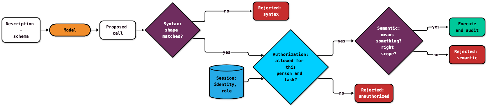

A support assistant has two tools: `create_customer` and `get_customer`. Someone types "Move ana@example.com to the pro plan." Ana is already a customer. There's no tool for changing plans.

The model proposes `create_customer` with Ana's email, her name, and `tier: "pro"`. Every field is present, every type is right, and `pro` is one of the allowed plan names. The call passes validation. Now there are two Anas.

That one is invented, but you've probably shipped its cousin. The schema did its job perfectly. Nobody asked it the right question.

This is part of my [context engineering series](https://substack.com/@soypetetech). Last time I argued that a model's request to use a tool is only a proposal, and your application code decides what runs. This post is about what that code needs to know to decide well, and how to test it.

## A few terms before we start

A **tool** is an operation your application offers to a language model: a name, a description, and a schema for its arguments. The **schema**, usually JSON Schema, lists the fields, their types, and the allowed values. When the model answers with a structured request to use a tool, that's a **tool call**, and I treat it as a proposal.

The **harness** is the application code around the model. It sends context, receives proposals, checks them, executes the ones that pass, and returns results. An **agent** is a model calling tools in a loop through a harness.

## What a schema can and can't say

A `create_customer` schema can require `email` and `name`, require both to be strings, and limit `tier` to `free`, `pro`, or `enterprise`. That's useful. It rejects malformed calls before anything happens, and it documents the tool for the model.

Here's what it can't say:

- whether this customer already exists
- which source is authoritative for customer data, and how fresh it has to be
- who is allowed to create a customer, or to put one on `enterprise`
- whether a repeated request should create a second record or return the first

Those are questions about meaning, authority, and effects. A schema is about shape. If the schema is the only check in front of your tool, the only bugs you'll catch are typos.

## The description is how the model picks

Given a set of tools, the model predicts a call from the request, the tool definitions, the conversation, and whatever it learned in training. The description is the part of that you control.

Compare:

> `get_customer`: gets customer info

> `get_customer`: Look up an existing customer by email. Returns name, plan, and signup date. Use when someone asks about an account that already exists. Do not use to create or change an account.

The second one says what the tool does, what comes back, when to use it, and **when not to**. Two tools that sound alike are separated by their exclusions, not their purposes.

Be honest about the limit, though. No description would have saved Ana. "Do not use when the person already has a record" asks the model to know something it can only learn by calling `get_customer` first. The right behavior for that request was to abstain or ask: "I can't change plans; want me to flag this for billing?" The right fix for the *product* is a `change_plan` tool. When the model reaches for the wrong tool, check whether the tool it needed exists at all.

When the right tool exists and the model still picks wrong, sharpen the descriptions, merge overlapping tools, or route in code when your software already knows which operation it needs.

## The schema is one field of the contract

I think of each tool as an **action contract**: everything the harness knows about the operation. If you've used design by contract or a policy engine, this will look familiar: preconditions, effects, and who's allowed. The schema is one field. The rest are purpose, when to use and not use it, the evidence the call needs (a verified email before an account exists), whose identity it acts for and which records it may touch (its **scope**), and where its data comes from and how fresh it must be.

The model sees the description. The harness enforces the rest, in order.



*Each check answers a different question, so each one gets its own test.*

The order matters. Authorization runs before the semantic check, because the semantic check reads data. If the duplicate lookup ran first, a caller who isn't allowed to create customers could still learn from the error whether ana@example.com exists. And you'd pay for a query on a call you were going to reject anyway.

Keeping authority outside the model is also where current research points. Kodathala evaluated 15 models against eight attack scenarios and found that refusal ranged from 100% down to 38%; an identity-bound gateway in front of the tools doesn't stop a model from being deceived, but it stops a deceived model from acting beyond the verified user's authority ([Kodathala, 2026](https://arxiv.org/abs/2607.05518)). That result is scoped to its setup, but it's the case for authorizing in code, not in the prompt.

## Five tests, one tool

An **eval** is a fixed set of test cases with expected answers that you score your system against, the way unit tests score a function. For every tool, I want eval cases in five classes:

1. **Correct selection.** The right request picks this tool.
2. **No-tool abstention.** A request that no tool should handle gets no tool call.
3. **Malformed arguments.** A missing field or a value outside the enum is rejected.
4. **Schema-valid but semantically invalid.** Well-formed nonsense is rejected: a customer who already exists, or an email string that isn't an address.
5. **Unauthorized.** A well-formed call from someone who isn't allowed is rejected.

Add one valid call that should execute, so you know the checks aren't just rejecting everything. In a real assistant I'd split abstention in two, "no tool" and "ask a clarifying question," because for Ana, asking is the best answer.

The companion Go example builds that eval for `create_customer`. Here `k` is the tool's contract, `c` the proposed call, and `p` the signed-in person:

```go
if err := checkShape(k, c.Args); err != nil {
	return fmt.Errorf("%w: %v", ErrSyntax, err)
}
if !hasRole(p, k.RequiredRole) { // p comes from the session, never from Args
	return fmt.Errorf("%w: %s lacks role %q for %s", ErrUnauthorized, p.ID, k.RequiredRole, k.Name)
}
if t, _ := c.Args["tier"].(string); t == "enterprise" && !hasRole(p, "sales") {
	return fmt.Errorf("%w: enterprise tier requires sales", ErrUnauthorized)
}
if err := h.checkMeaning(k, c.Args); err != nil { // duplicates, unparseable email
	return fmt.Errorf("%w: %v", ErrSemantic, err)
}
h.Executed = append(h.Executed, c) // stands in for running the tool
```

The [full program and tests](https://github.com/Soypete/ctx-eng-book/tree/main/book/examples/ch05.02-tool-schemas-and-function-calling) include the contract type, the description the model sees, and the eval cases. One test checks that an anonymous caller gets the same "unauthorized" for Ana and for an email that doesn't exist. The enterprise rule is hard-coded to keep the example short; in a real system it belongs in your policy data. Every error starts with its stage (`syntax`, `unauthorized`, `semantic`), so your logs, and the short error you return to the model, say where the call stopped.

The example stands in for the model's tool choice with a **selector**: a function that takes a request and returns a tool name, or nothing. The test I like most swaps in an "eager" selector that calls `create_customer` for every request. It sails through the happy path and fails only on the abstention cases, including "Move ana@example.com to the pro plan." The semantic check would block that one call, but it can't tell you the agent is reaching for tools it shouldn't. If your eval has no no-tool cases, an agent that always reaches for a tool looks perfect.

## Where this stops

The selector in the example replays fixed choices, so the selection cases test the harness and the eval's bookkeeping, not a model. A real selection eval runs each case several times against the actual model, reports a pass rate per class, and runs again whenever the model or a description changes.

The duplicate check lowercases the email before it looks, because `Ana@Example.com` and `ana@example.com` are the same person. But a lookup in the harness is not a guarantee. It has to read the authoritative store, not a replica that's behind, and two retries can both pass the lookup before either writes. The real guard against a second Ana is a unique constraint or an idempotency key in the store. The harness check gives the model a useful error; the store is what keeps the data clean.

## Guidelines

1. **Write "use when" and "do not use when" into every tool description.** Exclusions are what separate look-alike tools.
2. **Keep no-tool cases in every tool eval.** An eval without abstention can't catch an eager agent.
3. **Test five classes per tool, plus one valid call:** correct selection, abstention, malformed, semantically invalid, unauthorized.
4. **Authorize before any check that reads data.** Otherwise your error messages answer questions the caller wasn't allowed to ask.
5. **Take identity and role from the session.** Never let arguments carry them.
6. **Back duplicate checks with a unique key in the store.** The harness lookup explains the rejection; the store enforces it.

A good schema is necessary. It just answers the smallest question in the room. Next in the [series](https://substack.com/@soypetetech): what happens when one tool's output feeds the next, and a timeout lands in the middle of a money transfer.
