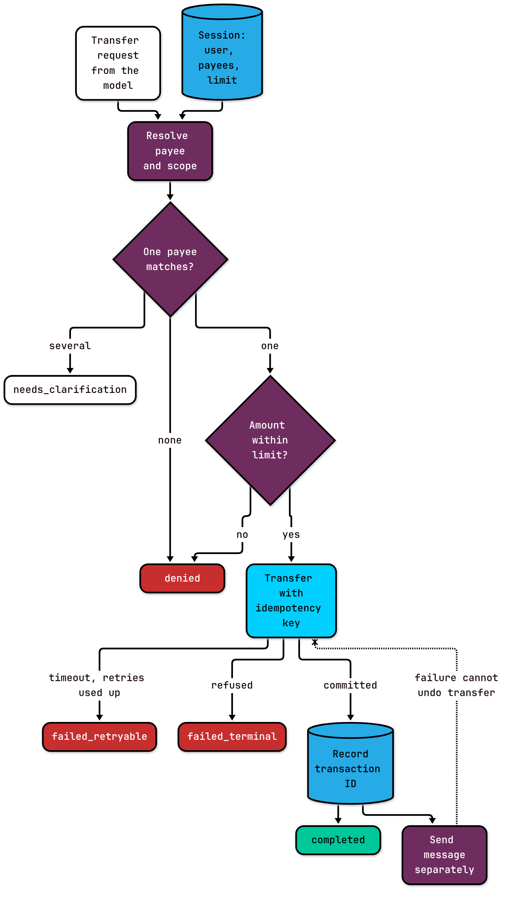

"Send Dana $1,200 for rent." The assistant finds Dana in the saved payees, calls the transfer tool, and waits. The payment service times out. The model sees an error and does the reasonable thing: it tries again. This time it works.

Dana now has $2,400. The first transfer went through; only the reply got lost.

I made up that scenario, but nothing about it is exotic. The model behaved sensibly with what it could see. The workflow around it never said what a timeout means or what a retry is allowed to do.

This is part of my [context engineering series](https://substack.com/@soypetetech). Last time I wrote about the tests a single tool needs before an agent can call it. This post is about chains of tool calls, where one result feeds the next step and a failure can land halfway through.

## A few terms first

A **tool** is an operation your application lets a language model request, like `transfer_funds` or `send_message`. The model's structured request to use one is a **tool call**, and I treat it as a proposal: nothing happens until code approves it. The **harness** is that code, the application logic that receives proposals, checks them, runs the approved ones, and returns results. An **agent** is a model calling tools in a loop through a harness.

**Routing** is deciding which tool calls happen, in what order, and what each one passes to the next. A **side effect** is a change in the outside world, like money moving or a message being sent.

## Routing is a pipeline problem

One tool call is simple. A workflow that resolves a payee, checks a limit, moves money, and sends a confirmation is a pipeline. Each stage needs typed input, produces typed output, and needs to know when the whole thing is finished.

Agents make that a loop: the model proposes a call, gets a result, and proposes the next one. The same problem shows up in extraction pipelines and ordinary workflow systems. Every step from one state to the next needs explicit state, explicit **scope** (which accounts and payees this user may act on), and exit criteria.

The key word there is *typed*. Each result can become input to the next stage, but not every value belongs back in the model's context. I want the harness to keep the workflow's state in its own structures, record where each value came from and when (a payee list loaded yesterday may miss today's change), pass along only the fields the next step needs, and keep credentials out of the prompt entirely.

And who and what the request is about gets settled first. Identity and scope have to be resolved before any result is allowed to authorize something downstream.



*The message is a separate step on purpose. If it fails, the transfer stays done.*

## Define "done" in code

"The task is complete when the request is fulfilled" sounds like an exit condition. It just restates the problem. Without endings the software can enforce, agent loops and workflow transitions can keep going.

For this workflow, every run ends in exactly one of five **terminal states**:

- `completed`, with the transaction ID
- `needs_clarification`: two saved payees are named Sam, so ask
- `denied`: an unknown payee, or an amount over the user's limit
- `failed_retryable`: the payment service never answered, so it's unknown whether money moved
- `failed_terminal`: the service refused, for example for insufficient funds

Bound the attempts per tool and per kind of error, so a retry policy can't become an infinite loop.

## A timeout is "unknown," not "failed"

Here's the part that would have saved Dana from getting paid twice. A timeout after `transfer_funds` doesn't prove the transfer failed. Retrying without protection may charge twice.

The protection is an **idempotency key**: a unique value the caller sends with a request so the service performs it at most once. If the same key arrives again, the service returns the original result instead of moving money again. The key has to come from the user's request, not from the attempt, so every retry carries the same one. A request ID assigned when the user hits send works. Next month's rent is a new request with a new key.

The companion Go example has a fake payment service that commits a transfer and then times out, which is exactly the failure in the opener. In the code, `Ledger` is that fake service, `s` is the signed-in session, `p` is the model's proposal, and `key` comes from the request. The retry loop reuses the key:

```go
for attempts < w.MaxAttempts {
	attempts++
	txn, err = w.Ledger.Transfer(key, s.Account, to, p.AmountCents) // same key every attempt
	if !errors.Is(err, ErrTimeout) {
		break
	}
}
switch {
case errors.Is(err, ErrTimeout):
	// Unknown whether it committed. A later run with the same key can't double-charge.
	return Result{Outcome: FailedRetryable, Attempts: attempts, Reason: "ledger timed out; retry with the same key"}
case err != nil:
	return Result{Outcome: FailedTerminal, Attempts: attempts, Reason: err.Error()}
}
// otherwise: completed with txn, then notify
```

The fake service only deduplicates when it gets a key. With the key, `TestTimeoutThenRetryChargesOnce` shows one transfer and one transaction ID after two attempts. In `TestRetryWithoutKeyChargesTwice`, the identical loop with an empty key moves money twice. Same code, same model behavior, one missing string.

The [full program and tests](https://github.com/Soypete/ctx-eng-book/tree/main/book/examples/ch05.03-tool-selection-routing-validation) cover all five terminal states and check that no money moves on any run that doesn't complete.

## Each side effect gets its own retry policy

After the transfer, the workflow sends the user a confirmation. Say the SMS provider is down.

A message failure must not roll back a committed transfer, and it must not cause the model to try the transfer again. In the example, the run still ends `completed` with the transaction ID, and the result's `Notified` field is false, so the notification can be retried on its own. The transfer and the message are separate side effects with separate retry policies.

When a workflow touches more than one system and something fails after a commit, you need **compensation**: an explicit follow-up action that offsets the committed step, like a refund. That's a deliberate business decision, not something the model should improvise by calling tools until the numbers look right. My example doesn't implement compensation; it just refuses to pretend a failed message undoes a transfer.

The last thing the harness controls is what the model sees afterward. The example returns a one-line summary: outcome, transaction ID, whether the notification went out, and a reason. No account numbers. The model needs enough to tell the user what happened, not the keys to do it again.

## Guidelines

1. **Name every terminal state in code.** `completed` (with an ID), `needs_clarification`, `denied`, `failed_retryable`, `failed_terminal`.
2. **Derive one idempotency key per user request and send it on every retry.** Test that a timeout followed by a retry charges once.
3. **Treat a timeout on a side effect as unknown.** Never as failed.
4. **Give each side effect its own retry policy.** A failed notification never re-runs a transfer.
5. **Resolve identity and scope before anything can authorize an effect.** Ambiguous payees end in `needs_clarification` with nothing moved.
6. **Return a summary to the model, not the workflow state.** Leave account numbers and credentials out.

Reliable systems don't hope for good behavior. They make unsafe proposals rejectable, repeated side effects idempotent, failures observable, and recovery deterministic. Next in the series: once your tools leave records like these outcomes and attempt counts, how to read the patterns in them as evidence for redesigning the tools.
